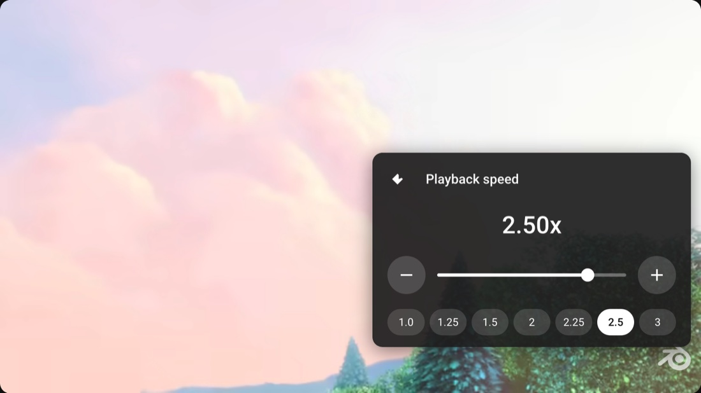

## 3x YouTube Browser Extension

YouTube caps its own speed menu at 2x and puts 3x behind Premium. This
extension replaces that row in the player's settings menu with one that is not
capped, so 3x is available like any other speed.



## What you get

- **Gear menu → Playback speed**: a panel modelled on YouTube's own, with a
  slider from 0.25x to 3x and the presets
  1.0 · 1.25 · 1.5 · 2.0 · 2.25 · 2.5 · 3.0.
- **One place to set the speed**: YouTube's original row is hidden, so the
  Premium-gated 3x is simply unlocked instead of duplicated.
- **It sticks**: the chosen speed is stored locally and re-applied to every new
  video, on navigation and on player rebuilds.
- **Keyboard**: <kbd>Alt</kbd>+<kbd>↑</kbd> / <kbd>Alt</kbd>+<kbd>↓</kbd> step by
  0.25x and show a large speed readout over the video. The panel and the menu
  row stay in sync, so opening them always shows what is playing.
- **No toolbar button**, no popup, no extra UI outside the player.

## Installation (Firefox or a Firefox-based browser)

### Temporary (until the browser restarts)

1. Open `about:debugging#/runtime/this-firefox`.
2. Click *Load Temporary Add-on…* and select `3xYouTube/firefox/manifest.json`.
3. Play any video and open the player's gear menu.

Repeat step 2 after every browser restart.

### With web-ext (reloads the extension when you edit the source)

```sh
npx web-ext run --source-dir 3xYouTube/firefox
```

On a Firefox fork, point it at that binary instead:

```sh
npx web-ext run --source-dir 3xYouTube/firefox \
  --firefox /Applications/Zen.app/Contents/MacOS/zen
```

### Permanent

A permanent install needs an XPI signed by
[addons.mozilla.org](https://addons.mozilla.org/developers/). Release builds of
Firefox refuse unsigned extensions — `xpinstall.signatures.required = false`
only has an effect on Nightly/Developer Edition.

## Usage

Open the player's gear menu, choose *Playback speed*, then drag the slider,
press ⊖/⊕ (±0.25x) or pick a preset. *‹* closes the panel and returns to the
settings menu.

Keyboard shortcuts work without opening any menu, and each press shows the new
speed for a moment over the video.

## Notes and limitations

- The extension injects its row into YouTube's own settings menu and hides the
  native one. If YouTube changes that markup, the worst case is that both rows
  appear; nothing else breaks.
- The row label is copied from YouTube's row, so it follows the player's
  language.
- The rate is applied to whatever media the player is showing, ads included.
- Requires Firefox 142+ (the manifest declares
  `data_collection_permissions`, which older versions do not know).
- Everything is local: the chosen speed is the only thing stored, in
  `storage.local`.

## Development

```sh
npx web-ext lint --source-dir 3xYouTube/firefox   # 0 errors, 0 warnings
```

After editing, reload the temporary add-on in `about:debugging` (or let
`web-ext run` do it) and refresh the YouTube tab.

## Files

| File | Purpose |
| --- | --- |
| `manifest.json` | Manifest V2, permissions, keyboard commands |
| `content.js` | Playback rate handling, panel, on-screen readout, menu row |
| `player.css` | Styling for the panel and the readout |
| `background.js` | Maps the keyboard shortcuts to messages for the active tab |
| `icons/` | Icon set (16/32/48/96/128) |
